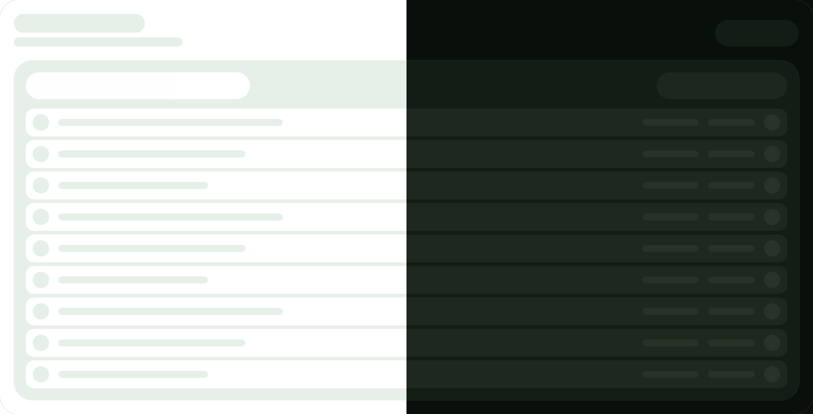
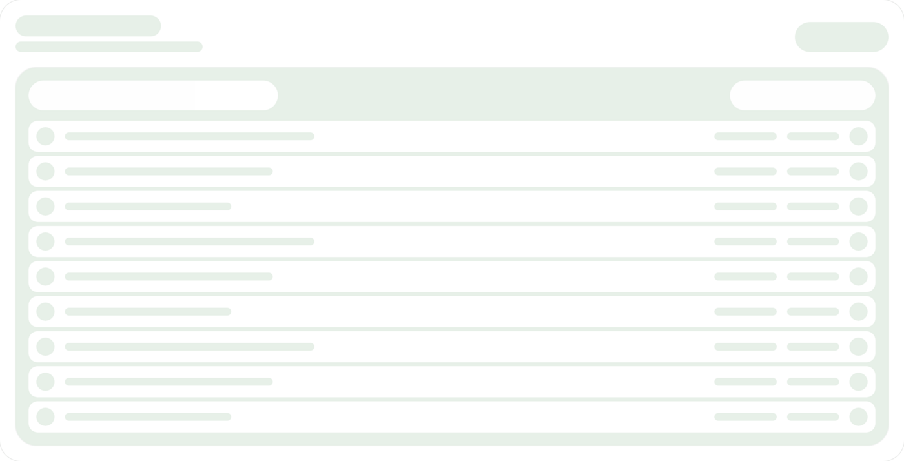
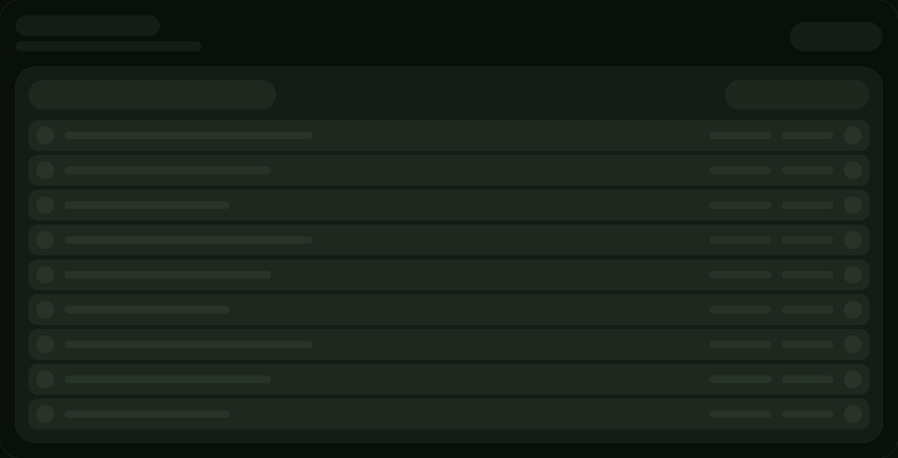
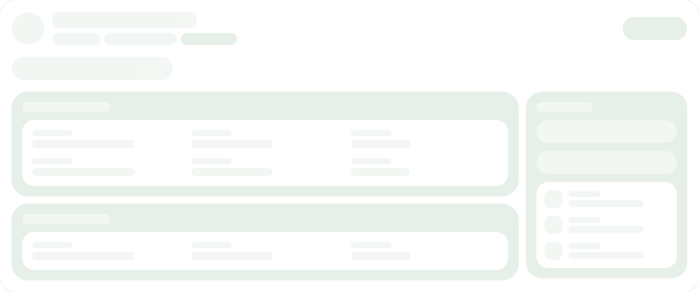
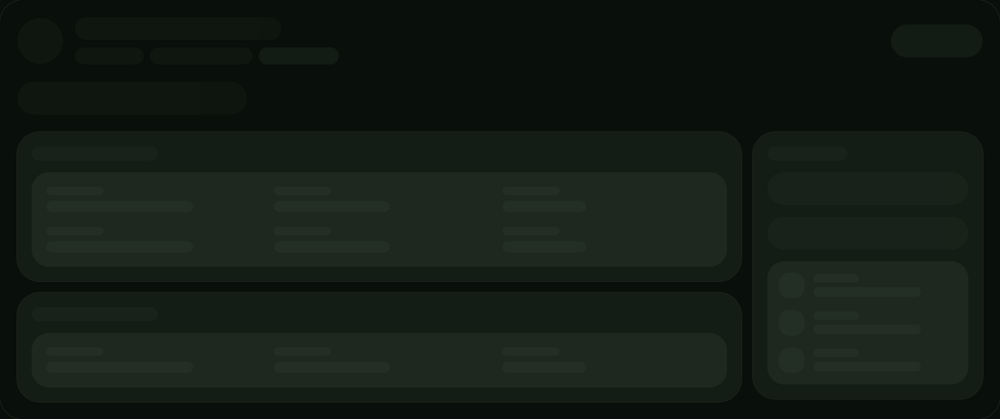
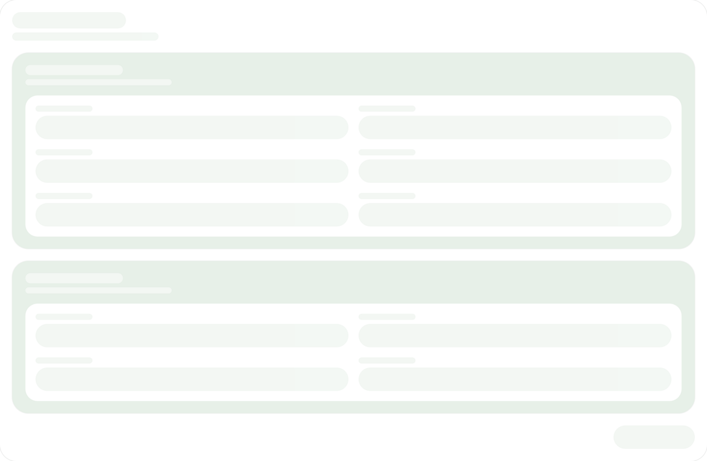
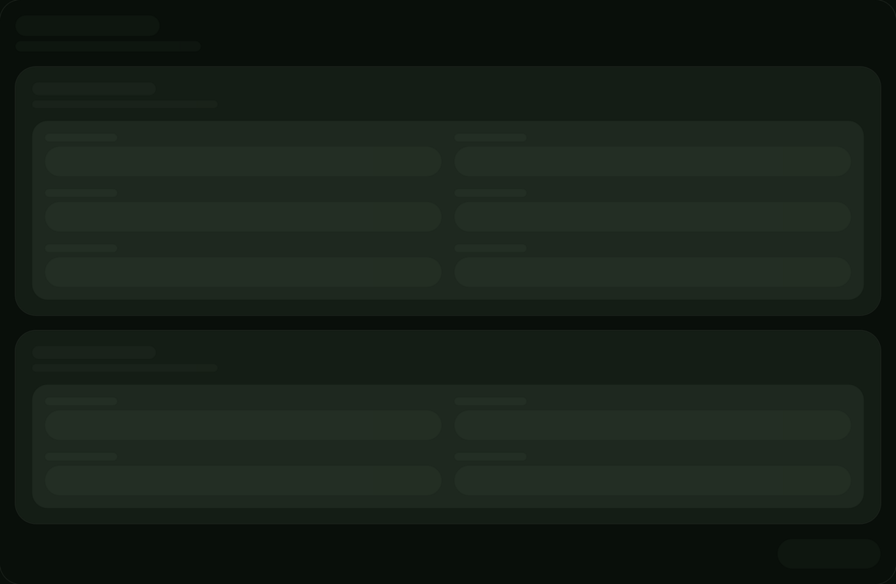
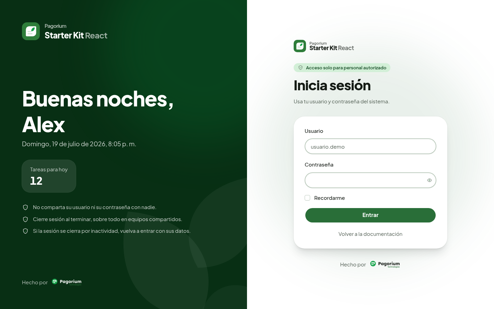

<div align="center">



# Pagorium Starter Kit React

**Diseño, componentes, íconos y pantallas listos para arrancar aplicaciones internas y de gestión con React.**

[](https://nextjs.org)
[](https://react.dev)
[](https://tailwindcss.com)
[](https://www.typescriptlang.org)
[](LICENSE)

</div>

---

Plantilla de código abierto de **Pagorium** para arrancar aplicaciones internas y de gestión, al estilo de los
starter kits de Laravel: tema, componentes, íconos y pantallas completas hechos con React 19, Next.js 16,
Tailwind CSS 4 y Radix, sobre la base de [shadcn/ui](https://ui.shadcn.com). Es neutra: no trae lógica de
ningún negocio, solo la base visual y las piezas para que cada pantalla nueva salga igual que las demás.

## Contenido

- [Vista rápida](#vista-rápida)
- [La idea](#la-idea)
- [Qué trae](#qué-trae)
- [Requisitos](#requisitos)
- [Empezar](#empezar)
- [Usarlo en un proyecto existente](#usarlo-en-un-proyecto-existente)
- [Estructura](#estructura)
- [Esqueletos de carga](#esqueletos-de-carga)
- [Temas](#temas)
- [Documentación integrada](#documentación-integrada)
- [Scripts](#scripts)
- [Contribuir](#contribuir)
- [Licencia](#licencia)

## Vista rápida

Los esqueletos de carga tienen la misma forma que la pantalla que viene, en claro y en oscuro:

| | Claro | Oscuro |
|---|---|---|
| **Lista** |  |  |
| **Ficha** |  |  |
| **Formulario** |  |  |

Y una de las pantallas completas que vienen de ejemplo, el inicio de sesión:



## La idea

- **Marco salvia, tarjetas blancas.** Las secciones van en un marco salvia y lo que se lee o se edita va en
  tarjetas blancas dentro. Las tablas son filas tarjeta separadas.
- **Íconos «línea de hoja».** Un solo trazo de 1,4 en la tinta del ícono y la pieza clave en el verde de la
  marca; contenedores con esquina de hoja.
- **Medidas parejas.** Botones y campos de 46 px, contenedor de 1500 px, tipografía Plus Jakarta Sans.
- **Claro, oscuro y verde.** Los tres temas con la misma jerarquía de superficies.
- **Carga sin saltos.** Esqueletos de lista, ficha y formulario, y filas con brillo al filtrar.
- **Copiar y pegar.** Como shadcn/ui: el código es tuyo. Cada ejemplo de la documentación trae su código
  completo para copiarlo.

## Qué trae

### Primitivos (`components/ui`)

Más de 50 componentes basados en shadcn/ui y Radix, ajustados al sistema: acordeón, alerta y diálogo de
alerta, avatar, insignia, migas de pan, botón y grupo de botones, calendario, tarjeta, carrusel, gráficas
(Recharts), casilla, colapsable, comando (cmdk), menú contextual, diálogo, cajón (Vaul), menú desplegable,
estado vacío, campo, tarjeta flotante, grupo de entrada, OTP, entrada, ítem, tecla, etiqueta, barra de menú,
select nativo, menú de navegación, paginación, popover, progreso, radio, paneles redimensionables, área de
desplazamiento, select, separador, hoja lateral, barra lateral, esqueleto, deslizador, avisos (Sonner), spinner,
interruptor, tabla, pestañas, área de texto, toggle y tooltip.

### Composiciones (`components/kit`)

Piezas de página hechas con los primitivos y los íconos:

| Grupo | Componentes |
|---|---|
| Estructura | `AppShell`, `AppHeader`, `AppSidebar`, `AppContent`, `PageHeader`, `Heading`, `Breadcrumbs` |
| Navegación | `NavMain`, `NavUser`, `NavFooter`, `UserMenuContent`, `QuickSearch` (Ctrl K) |
| Listas | `ListCard`, `DataTable`, `RowActions`, `StatusBadge`, `PaginatorLinks` |
| Fichas | `DetailList`, `ReadField`, `MetricSection`, `InitialsAvatar`, `UserInfo` |
| Formularios | `FormSection`, `FormField`, `FormActionBar`, `PasswordInput`, `SearchableSelect`, `DatePicker`, `InputError` |
| Carga | `PageSkeleton` y `skeletonKind()` para elegir el esqueleto según la ruta |
| Avisos | `FlashMessages`, `FloatingNotice`, `AlertError`, `Tour` (recorrido guiado) |
| Apariencia | `ThemeToggle`, `AppearanceTabs`, `AppearanceDropdown`, `useAppearance()` |
| Pantallas | `StatusScreen` (error, sistema cerrado y otros estados), `BrandPanel` |

### Íconos (`components/icons`)

Íconos de línea propios con los **mismos nombres que Lucide**, así que cambiar de uno a otro es cambiar el
import. Están agrupados en acciones, personas, lugares, registros, atajos y glifos, más un juego de
ilustraciones para estados vacíos y pantallas de estado.

### Marca (`components/brands`)

Logo del starter kit (`StarterKitLogo`, `StarterKitMark`), logo de Pagorium y la firma «Hecho por Pagorium»
(`MadeByPagorium`).

### Pantallas de ejemplo (`app/ejemplos`)

| Ruta | Pantalla |
|---|---|
| `/ejemplos/acceso` | Inicio de sesión con panel de marca, saludo según la hora y recordatorios. |
| `/ejemplos/403` | Acceso denegado: el usuario no tiene permiso para la ruta. |
| `/ejemplos/404` | Página no encontrada (la misma de `app/not-found.tsx`). |
| `/ejemplos/419` | La página expiró: sesión o formulario vencidos. |
| `/ejemplos/500` | Error inesperado (la misma de `app/error.tsx`). |
| `/ejemplos/cerrado` | Sistema cerrado o fuera de horario. |

### Páginas de error

Las cuatro usan `StatusScreen` con el panel de marca, el código con su ícono y tono, qué puede hacer la
persona y la dirección y hora para reportarlas a soporte:

| Código | Archivo | Cuándo sale |
|---|---|---|
| 403 | `app/ejemplos/403/page.tsx` | Ejemplo para copiar donde la app niegue un permiso. |
| 404 | `app/not-found.tsx` | Solo: cualquier dirección que no existe o una llamada a `notFound()`. |
| 419 | `app/ejemplos/419/page.tsx` | Ejemplo para copiar cuando venza la sesión o el token del formulario. |
| 500 | `app/error.tsx` | Solo: cualquier error al mostrar una página; «Volver a intentar» llama a `retry()`. |

## Requisitos

- Node.js **20.9** o superior
- npm (o el gestor que prefieras)

## Empezar

```bash
git clone https://github.com/slzno/pagorium-starter-kit-react mi-app
```

```bash
cd mi-app
```

```bash
npm install
```

```bash
npm run dev
```

Abre <http://localhost:3000> para ver la documentación con todos los componentes.

## Usarlo en un proyecto existente

Para un proyecto con Next.js y Tailwind CSS 4:

1. **Instala las dependencias:**

   ```bash
   npm install class-variance-authority clsx cmdk date-fns embla-carousel-react input-otp motion next-themes radix-ui react-day-picker react-resizable-panels recharts sonner tailwind-merge tw-animate-css vaul
   ```

2. **Copia el tema** (`app/theme.css`) desde la sección **Tema** de la documentación e impórtalo una vez en el
   layout raíz, con la fuente Plus Jakarta Sans:

   ```tsx
   import { Plus_Jakarta_Sans } from 'next/font/google';
   import './theme.css';

   const jakarta = Plus_Jakarta_Sans({ variable: '--font-jakarta', subsets: ['latin'] });

   export default function RootLayout({ children }: { children: React.ReactNode }) {
     return (
       <html lang="es" className={jakarta.variable}>
         <body>{children}</body>
       </html>
     );
   }
   ```

   Si tu proyecto ya usa shadcn/ui, puedes copiar solo los **tokens** y pegarlos en tu `globals.css`.

3. **Copia los componentes que necesites.** Empieza por `lib/utils.ts`, `components/icons` y
   `components/ui`; las composiciones de `components/kit` se apoyan en ellos. Cada sección de la
   documentación tiene su pestaña **Código** y el **Catálogo** trae cualquier archivo.

## Estructura

```
.
├── app/
│   ├── theme.css        # Tokens, temas, tablas, esqueletos y alineación claro/oscuro
│   ├── globals.css
│   ├── layout.tsx
│   ├── page.tsx         # Documentación y ejemplos de todo
│   ├── _docs/           # Secciones, ejemplos y su código para la documentación
│   ├── codigo/          # Ruta estática que entrega el código de la plantilla para copiarlo
│   ├── not-found.tsx    # Página 404
│   ├── error.tsx        # Página 500
│   └── ejemplos/        # Pantallas completas: acceso, cerrado, 403, 404, 419 y 500
├── components/
│   ├── ui/              # Primitivos (botón, campos, select, diálogo, tabla, pestañas…)
│   ├── kit/             # Composiciones de página
│   ├── icons/           # Íconos de línea con nombres de Lucide e ilustraciones
│   └── brands/          # Logos y firma de Pagorium
├── hooks/               # use-mobile
├── lib/                 # utils (cn)
└── docs/screenshots/    # Imágenes de este README
```

## Esqueletos de carga

`PageSkeleton` tiene tres formas —`list`, `detail` y `form`— para que la carga se parezca a lo que viene.
`skeletonKind()` adivina cuál usar a partir de la ruta de destino:

```tsx
import { PageSkeleton, skeletonKind } from '@/components/kit';

skeletonKind('/pedidos');          // 'list'
skeletonKind('/pedidos/12');       // 'detail'
skeletonKind('/pedidos/12/edit');  // 'form'

<PageSkeleton kind={skeletonKind(pathname)} />;
```

Con `formSegments` y `listPrefixes` se ajusta a las rutas de cada proyecto (por ejemplo, para que
`/reportes/2026` siga siendo una lista).

## Temas

El tema vive en `app/theme.css` con colores en OKLCH:

- **Claro salvia:** página blanca, marcos salvia (`--frame`) y tarjetas blancas dentro.
- **Oscuro:** la misma jerarquía de superficies con un verde muy tenue para no teñir la pantalla.
- **Verde:** variante de marca.

La apariencia (claro, oscuro o la del sistema) se guarda en `localStorage` con la clave `marco-appearance` y se
cambia con `ThemeToggle`, `AppearanceTabs` o el hook `useAppearance()`.

## Documentación integrada

La página principal (`/`) es la documentación. Cada sección tiene las pestañas **Vista previa** y **Código**:
el código es el mismo ejemplo que se ve, completo, junto con los archivos que usa. Además:

- **Instalación:** los pasos de arriba con botón para copiar.
- **Tema:** copia los tokens (para cualquier proyecto con shadcn) o el CSS completo.
- **Catálogo:** abre y copia el código de cualquier archivo de la plantilla.

Secciones: colores, botones, campos, controles, listas, fichas, formularios, esqueletos, navegación, pestañas,
modales, búsqueda, avisos, cifras, íconos e ilustraciones.

## Scripts

| Comando | Qué hace |
|---|---|
| `npm run dev` | Servidor de desarrollo en <http://localhost:3000>. |
| `npm run build` | Compila para producción (todas las rutas son estáticas). |
| `npm run start` | Sirve la compilación de producción. |
| `npm run lint` | Revisa el código con ESLint. |

## Contribuir

Los reportes y las propuestas son bienvenidos en
[Issues](https://github.com/slzno/pagorium-starter-kit-react/issues). Antes de abrir un pull request:

1. Mantén los nombres, comentarios y textos en español, como el resto del código.
2. Respeta las medidas del sistema (46 px, marco salvia, tarjetas blancas) y prueba en claro y en oscuro.
3. Si agregas un componente, agrega también su ejemplo en la documentación.
4. Corre `npm run lint` y `npm run build`.

## Origen

Pagorium Starter Kit React fue creado por el desarrollador Luis Solórzano y se publica como
plantilla de código abierto de [Pagorium Technologies](https://pagorium.com).

## Licencia

MIT © 2025-2026 [Pagorium Technologies](https://pagorium.com). Ver [LICENSE](LICENSE).

Los componentes de `components/ui` parten de [shadcn/ui](https://github.com/shadcn-ui/ui) (MIT © 2023 shadcn);
su aviso de licencia va incluido en `LICENSE`.

<div align="center">
  <sub>Hecho por <a href="https://pagorium.com">Pagorium</a></sub>
</div>
